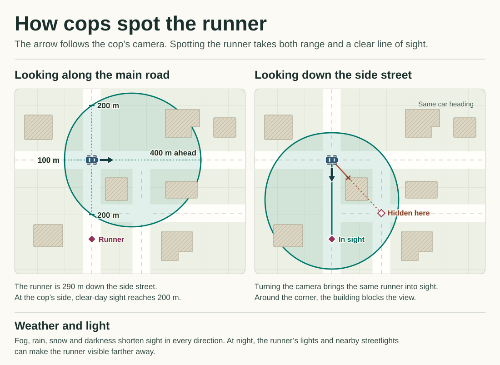

# Where a cop can spot the runner

A cop driving through an intersection can look down a side street and spot a runner 290 metres away. Looking straight ahead, the same runner is too far to acquire. A building between the cars blocks both views. At night, switching off the runner’s lamps or leaving a pool of streetlight can help the runner disappear. The existing SPOTTED/HIDDEN indicator, live positions and last-seen updates carry those outcomes.



## Why

Today a human cop with an unobstructed line to the runner reports the same sighting at 290 m whether looking ahead, across an intersection or behind the car. Darkness and fog can make the runner hard for the player to pick out while the game still broadcasts their position. That costs both sides a decision. A cop gains little by checking the side street, and a runner gains little by leaving the lit main road.

Practice has a separate gap. Its AI cops can drive after the runner, but the current sight-report path accepts human cops. A player practicing as the runner should be able to try hiding in an alley and see whether each pursuing car could still spot them.

## Goals

- Give a human cop a reason to look into a turn and a runner a reason to choose where to break sight. The same two parked cars can gain or lose a sighting when the cop changes where they look or the runner switches on their lights.
- Let conditions on the runner's stretch of road matter. At midnight a runner under a working streetlight should be easier to spot than the same runner outside the light. During changing weather, the distance should follow the blend.
- Give each Practice cop its own view and keep the chase running through a loss. A player should be able to compare the result in Practice with what happens against a human cop.
- Keep the host's one **Sight range** control meaningful. It sets the forward clear-day distance and scales the rest. Explain this and the effect of turning the view in the existing player instructions.

## Non-goals

- New host controls, player preferences, HUD indicators, weather types or leaderboard categories.
- Simulating eye movement, mirror images, individual damaged bulbs, brake lamps or a camera's rendered exposure.
- Changing how a Practice cop searches or steers, how the helicopter sees, when a catch completes or how a player chooses a route. The change supplies ground observations to the existing rules.

## Anti-goals

- The runner gets **SPOTTED** because a cop zoomed over a building or switched to a nearby vehicle while their assigned car was still behind cover.
- Two Practice cops facing opposite ways always report the same sight, or a replaced AI cop earns sight time from the previous car's delayed report.
- A dark tunnel receives a bonus from a lamp on the bridge above it, a helicopter searchlight or a glowing mesh without an emitter. The runner should be in light that can reach their car.
- A large city causes a hitch every time a cop checks sight, or an unavailable engine reading silently grants full clear-day range.

## User decisions

- Human cops spot furthest where they look with an attached driving camera. Practice AI uses its car heading. Both check sight from their own car.
- In clear daylight, looking at the runner gives 400 m by default. A cop looking ahead can spot a runner 200 m directly behind the car through its mirrors. Turning the camera to look straight back gives 400 m there. The 100 m minimum still applies directly opposite the gaze outside the mirrors’ coverage. The host can scale the range or turn ground sight off.
- Practice AI keeps chasing the assigned runner while the runner is **HIDDEN**.

The shape and width of the mirror coverage, the gaze curve between the agreed distances, the night and weather multipliers and the range gained from lights are starting values for the first playtest. The examples below use those values.

## What happens in a chase

Consider two human cops, Mara and Jules, on a clear day with the default settings. The helicopter is off. Mara is at the intersection in the diagram, the runner is 290 m down the side street, and Jules has yet to round the corner. Times below are seconds on the server after the cops are released. The example uses ticks on the indicated boundaries.

| Time | What the cops do | What the players get |
|---|---|---|
| 0 s | Mara looks down the street. The runner is within her 400 m forward range and the street is clear. | The runner sees **SPOTTED**. Both cops receive the live runner position. Mara starts earning sight time. |
| 2 s | Mara looks back to the main road. The runner is now outside her 200 m side range and she reports loss. | Mara's 1.5 s grace starts. The team keeps the live position. |
| 3 s | Jules rounds the corner and sees the runner directly. | Both cops now count, Mara through grace and Jules through his own sighting. The runner sees no change. |
| 3.5 s | Mara's grace expires. | Only Jules earns sight time. Mara still receives the team's live position. |
| 5 s | The runner turns behind a building. Jules reports loss and his own grace starts. | The runner stays **SPOTTED** during this final grace period. |
| 6.5 s | Neither cop has reacquired the runner. | The runner sees **HIDDEN**. The cops receive a last-seen position. It stays there as the runner drives on. |

The runner's indicator answers “Does any ground cop have sight?” Each eligible cop accrues sight time separately, including their own grace. Live positions go to participating human cops at the existing interval (default 1 s). On each live update, the server checks a separate route threshold for cops who already count as seeing the runner. A cop within that speed-dependent distance gets **IN SIGHT** and their route preference decides whether the route stays drawn. A cop farther away can earn sight time while their HUD reads **LIVE**. A partner with no personal sight also gets **LIVE**.

If the helicopter were tracking at 6.5 s, the runner would still see **HIDDEN** and both cops would continue receiving live positions. The helicopter supplies its own track and gives neither cop individual ground sight. Once both ground and air tracking are lost, the server sends the last-seen position once. Catch conditions continue to use their existing distance, speed and timing rules.

## Direction and distance

The host’s **Sight range** sets how far a cop can trigger a shared spotting report in clear daylight. A player can still see a car 500 m away on an open road. The 400 m default limits when a cop can share that sighting with the team. At a 200 m setting, a cop looking straight ahead gets 200 m ahead, 100 m to either side and 100 m directly behind the car. Looking due left at a runner there gives 200 m there. A runner directly opposite on the right gets 50 m. Off (0) disables ground sight, including Practice.

There is a reason to reward looking. While viewing pursuit footage, drivers narrowed their visual search during nighttime pursuits. In a separate simulator study, drivers intentionally following another vehicle spent more time looking at it, scanned a narrower area and were less aware of pedestrians. Our inference is that pointing the view down a street should improve the chance of recognizing the runner there. The camera approximates attention. The metre values and curve are gameplay tuning. [Pursuit footage study](https://pubmed.ncbi.nlm.nih.gov/14570510/) · [Intentional car-following study](https://doi.org/10.1068/p5105)

A cop facing north can spot a runner 180 m due south while watching the road ahead. The same runner at 260 m needs a deliberate look back. If the cop turns the camera west, the mirrors still cover the road to the south. The street due east is directly opposite the gaze and has only 100 m of range. A wall behind the cop blocks a mirror sighting just as it blocks a direct look.

Two horizontal angles determine how much of the host range R applies. The gaze angle θ measures how far the runner is from the direction the cop looks. The mirror angle β measures how far the runner is to either side of the assigned car’s rear axis. Human and Practice cops use the same calculation.

```text
gaze              = 2^(cos θ − 1)
u                 = clamp(1 − β / 30°, 0, 1)
mirror floor      = 0.25 + 0.25 × u² × (3 − 2u)
directional range = R × max(gaze, mirror floor)
```

The gaze gives about 327 m at 45° from the look direction. The proposed mirror floor gives 200 m directly behind the car, 150 m at 15° off the rear axis and 100 m at 30° or farther. Beyond that taper, the gaze alone determines range. Turning the camera can improve the gaze range while the mirror floor stays fixed to the car. Looking directly at the runner gives the full 400 m anywhere.

The rear axis points directly opposite the assigned car’s horizontal forward vector. Use that axis for the mirror and the horizontal car-to-runner displacement for both angles. If the car heading is unusable, omit the mirror contribution. A usable camera gaze still counts. With an unusable gaze use its quarter-range minimum. With zero or unusable horizontal displacement, both angles are unavailable and the range is R/4. The final check uses the existing inclusive 3D eye-to-target-centre distance, so an overpass still adds vertical separation. Invalid world positions give a missed observation.

### Whose eyes count

| Observer or camera state | Direction for this sample | Reason |
|---|---|---|
| Human cop, player 0 viewing their assigned round car, free camera off, attached driving view | Camera forward for orbit, chase, driver/occupant and JBeam onboard views | A glance down the street can acquire the runner before the car turns. |
| Human cop using free, map, path, cinematic, relative free-moving or unknown camera, or viewing another car | Assigned cop car forward | The cop can change seats or inspect the map without borrowing the other viewpoint. |
| Missing/failed camera read or near-vertical camera direction | Assigned cop car forward | Looking straight up has no usable horizontal bearing. If the car heading is unusable too, give the shortest angular range. |
| Practice AI cop | That AI car's forward vector | Two AI cops facing opposite ways make independent observations, whichever seat the issuer occupies. |
| Assigned cop car missing, or runner car unavailable | Miss this observation | A spare car and an unspawned car cannot stand in for a participant. |

Practice uses the same range, lighting, weather, cover and grace when the issuer drives the runner, drives a cop or watches an AI-only round. A Practice cop keeps driving after the assigned runner when sight is lost. BeamNG's chase target survives a change of seat. Turning the issuer's camera affects only the sight of a human cop driving their assigned car.

### Where the sight ray starts and ends

First resolve both assigned cars. For a remote human runner use the current server-announced round-car key. Before registration, after removal or while that car is unspawned, report out of sight and skip the rays. A nearby spare car or trailer owned by the same player can otherwise produce a convincing but false sighting.

Check the effective range to the runner's centre before testing cover. The eye is 1.2 m above the cop car. Test three points 1 m above the runner car, one at its centre and two displaced 2 m fore and aft along its horizontal heading. At least one point must clear a static ray in both directions within the existing 0.5 m tolerance. A partly exposed car can therefore be spotted around a corner. Zooming the orbit camera over a wall leaves the eye on the same side of the wall as the cop.

## Approaches

1. **Car heading for every cop.** One direction source works for human and AI cars and follows a car through a turn. Mara's deliberate glance in the example could never acquire the runner until she steered.
2. **Attached camera direction, rays from the car (chosen).** Captures the glance while the car fixes the physical viewpoint. Car heading is already meaningful for an AI cop and is available to a human cop when a camera cannot be classified.
3. **Camera direction and camera origin.** This would best match what appears on screen, including a view around an obstruction. It would also let a player park behind cover and move the orbit camera past it to share the runner's live location.

Use a smooth angular curve with the chosen approach. A gradual camera turn then brings successively more of the side street into range without a jump at a cone boundary.

## Darkness, lights and weather

All the environmental effects scale the directional range. For daylight D, runner low/high beam L and the strongest local streetlight S, normalized to [0,1], use

```text
night visibility   = 0.30 + 0.25 × L + 0.20 × S
lighting factor    = D + (1 − D) × night visibility
fog factor         = 1 − 0.60 × clamp((rawFog − 0.0004) / 0.0146, 0, 1)
effective range    = directional range × lighting factor × fog factor × precipitation factor
```

| Runner, weather and lighting | Looking at runner | Looking forward, runner beside or directly behind car | Opposite sideways gaze, outside mirror coverage |
|---|---:|---:|---:|
| Clear day | 400 m | 200 m | 100 m |
| Cloudy day (raw 0.001) | 390 m | 195 m | 98 m |
| Day, rain preset (raw 0.002) | 318 m | 159 m | 79 m |
| Day, storm preset (raw 0.004) | 239 m | 119 m | 60 m |
| Day, thunderstorm preset (raw 0.004) | 239 m | 119 m | 60 m |
| Day, snow preset (raw 0.005) | 243 m | 122 m | 61 m |
| Day, dense fog (raw 0.015), dry | 160 m | 80 m | 40 m |
| Clear night, unlit road, lamps off | 120 m | 60 m | 30 m |
| Clear night, unlit road, lamps on | 220 m | 110 m | 55 m |
| Clear night, full streetlight, lamps off | 200 m | 100 m | 50 m |
| Clear night, full streetlight, lamps on | 300 m | 150 m | 75 m |

### A night drive as rain starts

Suppose Mara is looking directly at a runner 170 m ahead on a flat, unobstructed street after dark. The weather is halfway from cloudy to rain. At the sampled spot a streetlight gives half strength. Suppose the fog getter reads 0.0015, the midpoint of those two presets. The fog factor is about 0.955 and the precipitation factor is halfway from 1.00 to 0.85, or 0.925.

| Runner's action | Lighting factor at night | Forward range with this weather | Mara's observation |
|---|---:|---:|---|
| Lamps off in the half-strength pool | 0.30 + 0.20 × 0.5 = 0.40 | 141 m | Miss |
| Switch on low beam in the same spot | 0.30 + 0.25 + 0.20 × 0.5 = 0.65 | 230 m | Seen |
| Drive onto an unlit stretch with lamps on | 0.30 + 0.25 = 0.55 | 194 m | Still seen at 170 m |
| Switch lamps off there | 0.30 | 106 m | Loss, followed by the usual grace |

Each row holds distance, bearing and weather constant to show the effect of the runner's choice. For the second row, 400 × 0.65 × 0.955 × 0.925 gives about 230 m. In full daylight with the same rain and fog blend, the lighting factor rises to 1 and the forward range is about 353 m on either stretch. Clear daylight gives the full 400 m.

### Daylight and twilight

Read the map’s clock from `core_environment.getTimeOfDay()` and sunrise and sunset from `core_solarTimeOfDay.getSolarTimeOfDayValues(tod)`. These share BeamNG’s wrapped 0–1 clock. Derive a signed distance in days to the nearer solar boundary, positive inside the sunrise-to-sunset interval. Smoothstep from D=0 at 30 in-game minutes before sunrise to D=1 at 30 minutes after, reversing at sunset. This gives D=0.5 at ordinary sunrise or sunset. Work across the clock wrap and cache solar anchors by map/location/date/UTC offset/DST.

For polar day or night use the `polar` field of `getSolarTimeOfDayEvents(tod)`. Where anchors are unavailable use a definite boolean from `core_environment.getLightState().isNight`. With neither signal use D=0. Players' graphics settings and rendered exposure have no part in this calculation.

### Fog and precipitation

1. Read the raw density and LevelInfo object from `core_environment.getFogDensity()`. The first return is in density units. When the object and measurement are valid, that density wins even if it differs from the preset.
2. When LevelInfo or its raw measurement is unavailable, take the endpoint densities from `sky.WEATHER`, interpolate them and divide by 1000 once. The environment state and CnR presets store density ×1000. Cloudy's 1 and rain's 2 in the example give raw 0.0015 halfway through.
3. Interpolate the precipitation factor between 1.00 for clear/cloudy/fog, 0.85 for rain, 0.75 for snow and 0.70 for storm/thunderstorm. Use `sky.weatherBlend()`'s already-smoothed progress for both precipitation and fallback fog. Dense fog and snow still shorten sight under a light.
4. An unknown endpoint contributes dense fog and 0.70 precipitation wherever its input is needed. Missing progress between different endpoints uses the more restrictive value for each input. Accept only finite measurements, clamp valid extremes and bound every multiplier.

### Runner lamps

Read the assigned runner's actual electrical switch state. A manual override of automatic headlights counts. Register the single `lights_state` key on that vehicle with GE’s `core_vehicleBridge.registerValueChangeNotification(runner, "lights_state")` and read `getCachedVehicleData(runner:getID(), "lights_state")` at sight cadence. Values 1 and 2 give L=1. Zero, unavailable or unrecognized gives L=0. Low and high beam both include the associated tail lamps.

BeamMP’s installed `MPElectricsVE` applies received `lights_state` to a spawned remote car. CnR already periodically resends it via `ownLights.syncCommand`. The observer may read the spawn default until electrics arrive. Drop local references on replacement, destruction and teardown. Refresh the registration for each vehicle lifetime, including a reused game ID. The bridge owns its shared, deduplicated registrations and callbacks and handles replacement/destruction invalidation.

### Which streetlights count

Look near the runner's centre for authored map PointLight and SpotLight emitters. The installed `core/environment.lua` uses dynamic `nightLight`, day/night intensity fields and TSStatic `child` links to actual LightBase objects. Include a map emitter with a true `nightLight`, positive `nightIntensity` or an authored TSStatic child link registered by that mechanism. A static mesh's `nightEmissive` alone, road classification, decorations without an emitter and spawned vehicle/camera/search lights do not qualify. Custom maps depend on which fields their author supplied.

| Known authored fixture | Geometry stored by the map |
|---|---|
| West Coast USA · `bridge_lightpole_light1111111` | SpotLight, `nightLight="1"`, `range=22`, `outerAngle=160` |
| Italy · `areaLight_cityWallLights_0360631` | PointLight, `nightLight="1"`, `radius=10` |

Both fixtures serialize `isEnabled=false`. Read the live object's enabled state and intensity when the runner passes it. Its saved state cannot tell whether that patch of road is lit tonight.

### How much light reaches the runner

- **Index once per mission.** Start at first eligible round setup. Enumerate scene class names once and process up to 128 names per frame, including linked fixtures. Use 32 m XY cells and cap point radius and spot range at 32 m. Keep up to 16 emitters per cell, retaining the lowest scene IDs. Keep the index across rounds on the same map, pause discovery when ineligible and perform no discovery while sight is Off. Invalidate it on mission end, disconnect or extension unload.
- **Select candidates at sight cadence.** Inspect the runner's cell and eight neighbours. Resolve the nearest eight candidates by 3D distance, breaking ties by ID. Share one target lookup across all cops per 0.25 s sample and skip it in full daylight. These limits deliberately undercount very dense or partly indexed scenes.
- **Test illumination.** Require an enabled emitter with positive intensity. Strength is 1 within half its effective radius, tapering linearly to 0 at its edge. For a spot, also require the runner inside the outer half-angle of the world-space forward axis. A static ray from emitter to target must be clear, so the bridge light cannot illuminate a runner under the deck. Take the largest single strength. A missing or stale object, unusable field, unavailable ray or unindexed area gives no bonus.

## Reporting to the server

### Who may report

| Sender on `cnr_sight` | Payload | Server checks |
|---|---|---|
| Participating human cop | `{seen=true\|false}` | Derive the cop from the event sender. Ordinary `Round:sightReport` accepts rostered human cops during the chase. |
| Practice issuer on behalf of one spawned AI cop | `{aiId=<slot>,instance=<spawn serial>,seen=true\|false}` | Running Practice, exact issuer, positive sight setting, integer rostered AI cop ID (−10 or lower) and live registered vehicle with the same instance serial. Resolve the cop through `carFor(slot)` and its issuer-owned server vehicle ID. |

Require an actual boolean in both forms. Reject a malformed optional AI ID outright. A Practice issuer who drives the runner or receives `cnr_spectate` to watch an AI-only round gets the maximum in their targeted `cnr_setupAI`. This lets that client sample its AI cops. A regular spectator or bystander receives no such authority.

### Change reports, grace and stale reports

Each observer samples at 4 Hz, sends on a change and sends a keepalive every 5 s. A missing previously reporting car or target produces a false observation. Each human and AI slot keeps its own last report and send time. The client observes camera angle, weather and cover locally. Only the sight result and, for AI, the slot and instance go into the report.

The server applies the existing 3D distance bound of host maximum + 50 m to each observer, including one in grace. At the default maximum, an observer at 451 m cannot contribute. A false report after true starts that observer's configured grace (default 1.5 s). Reacquisition clears the pending loss. If true reports simply stop arriving, the last true goes stale after 11 s. Using the same checks for AI and human cops preserves the team and individual accounting in the chase example.

### Replacing a Practice vehicle

Assign each locally spawned AI vehicle a new, monotonically increasing instance number within the connection. Include it in the existing issuer-only vehicle registration and in every sight report for that cop. Reset report state at round boundaries and on replacement.

A repeated registration of the same live instance preserves its sight. Deletion by its owner, reassignment of the vehicle ID, slot remap and round teardown clear the affected slot's seen, lost-at and freshness entries. If a new car reuses the same vehicle ID a moment later, require a fresh report from the new instance. A delayed true report for the old instance cannot restore its sight or grace. Replacing the Practice AI **runner** invalidates all observers' sight of the old target. The server credits AI observations to the individual slot and the existing Practice exclusion keeps those rounds out of the production leaderboard.

## What the current code establishes

- The client already tests the centre and two ends of the car with two-way static rays and sends changes and keepalives. The new inputs determine the range passed into that existing cover check. [Client sight](../../../client/lua/ge/extensions/copsAndRobbers/sight.lua)
- The server already decides which cops individually count, updates ground sight for the runner and decides whether ground or helicopter tracking can supply a live position. One player's observation can therefore guide a second cop without giving that second cop sight credit. [Round tracking](../../../server/CopsAndRobbers/cnr/round.lua) · [Grace and expiry](../../../server/CopsAndRobbers/cnr/sight.lua)
- The weather table stores slider densities, shares the storm preset with thunderstorm and already supplies smoothed progress for a transition. This lets solid rain and a change into rain use one calculation. [Client sky](../../../client/lua/ge/extensions/copsAndRobbers/sky.lua)

## First-playtest calls

Start with the continuous directional curve, the 60-minute twilight transition and the multipliers in the weather and lighting table. The driving studies inform the choice to reward looking. The exact acquisition distances are gameplay tuning. Try the 290 m side street for the gaze curve and a runner following on a straight for the mirror coverage. Judge lamp strength as the runner leaves a lit patch for a dark road. The defaults give the builder fixed values to test and the player a concrete baseline to judge.

## Automated acceptance

- Use fixed positions for a runner just inside, on and beyond the directional boundary. Pin mirror floors on both sides at 0°, 15° and 30° off the rear axis. Compare looking ahead and straight back, and pin the 100 m baseline opposite a sideways gaze. Cover an overpass, missing car heading with a valid camera gaze, zero XY separation and Off. Capture the car-to-car rays while moving the camera beyond a wall. A missing registered runner, even with a visible spare, must give a missed observation.
- Reproduce the environmental table and the changing-weather example from known inputs. Test dawn and dusk across the clock wrap, conservative fallbacks on missing signals, a manual lamp change and a replacement runner reusing a game ID. Check that worsening weather shortens or preserves the range, including at night.
- Build scene fixtures for the two authored lamps. Check spot direction, extent, disabled or zero-intensity fixtures, a blocked ray, overlapping lights, work per frame and maximum candidates per sample.
- Replay the two-cop timeline and a missing keepalive. Cover human reports, two independent Practice slots, wrong issuer, duplicate registration, delayed old-instance reports, AI-only observation and Practice with sight Off. Check a cop still chases the assigned runner through loss, reacquisition and a seat change. Run the complete Lua suite and existing leaderboard fixtures.

## Engine questions and in-game checks

The code and authored map fields identify what to read. The following observations still need the installed game. Use a temporary GE probe in freeroam first for camera names and forward vectors, solar anchors, live fog units and the two fixtures' live transforms, intensity and enabled state.

| Setup and action | Observable pass condition | What the game check settles |
|---|---|---|
| One player, clear-day Practice as cop. Hold the car heading with the AI runner 200–400 m down an open side street and rotate the attached view. Then leave the car behind a wall and look over it. | The individual cop acquires looking into the street, loses on looking away and cannot acquire over the wall. Read the tagged sample if another cop holds team sight. | Which installed camera modes supply the intended bearing and how the boundary feels to the player. |
| One player, clear-day Practice as cop. With the car pointing up an open straight and the runner about 260 m directly behind it, turn the attached view from forward to straight back. | The cop’s logged range rises from about 200 to 400 m, with acquisition on the deliberate look back. The logged rear angle stays near zero. | Whether the rear sighting feels like a glance in the mirrors followed by a deliberate look. |
| One player, night Practice as runner. Cross a working lamp's pool onto a dark stretch and toggle low beam. Compare per-cop distance, bearing and range in the tagged samples. | At comparable bearing, range drops outside the visible pool and increases with lamps on. | Whether the map emitter's live geometry matches the patch of road the player sees. |
| Two clients, clear night on an unlit straight. Park the runner about 170 m ahead of a cop looking at them. Disable automatic headlights and toggle the runner's lamps. | After electrical replication the cop reads each switch change. The runner becomes SPOTTED with lamps on and HIDDEN after loss and grace with lamps off, when no other cop has sight. | Delivery of a remote manual change to the observing cop's GE bridge. |

## Left to the builder

Use the current branch's bound round-car identity and vehicle lifetime hooks for its human and Practice paths. Choose the exact wording in the existing player instructions while preserving the player's displayed units. The implementation plan gives the module boundaries, fixtures and procedure for recording engine evidence. The playtest is where to settle how the starting distances feel. [Implementation plan](../plans/2026-11-18-cop-visibility.md)
